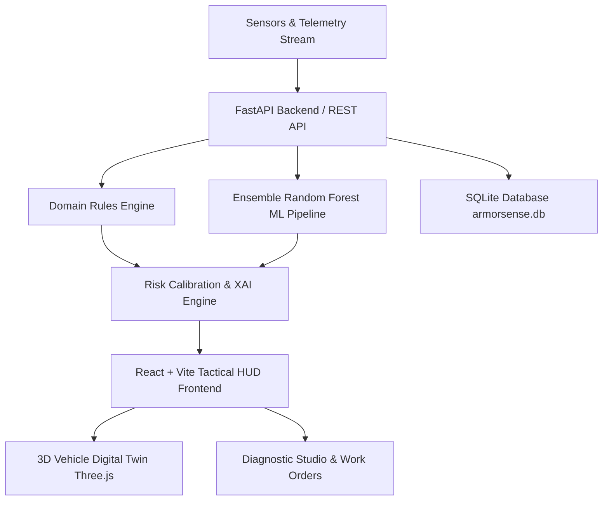

# ARMORSENSE — AI Predictive Maintenance Framework for Armored Combat Vehicles

**ARMORSENSE** is a state-of-the-art military HUD-styled predictive maintenance command center and digital twin platform. It provides real-time telemetry processing, deterministic engineering rule alerts, machine learning failure risk prediction, explainable AI (XAI) feature attribution, interactive 3D vehicle subsystem inspection, and closed-loop maintenance work order dispatching.

---

## ⚡ System Architecture



### 1. Backend (`/backend`)
- **Framework**: FastAPI with asynchronous lifespan management
- **Machine Learning**: Balanced Random Forest Classifier trained on 10,000 industrial machinery records with cost-sensitive class balancing (Accuracy: **98.4%**, ROC-AUC: **0.988**)
- **Explainable AI (XAI)**: Gini feature importance ranking and dynamic feature attributions
- **Database**: SQLite with SQLAlchemy ORM (`armorsense.db`) for tracking prediction audit logs and tactical maintenance work orders
- **Tests**: Pytest suite covering dataset ingestion, model inference, and REST endpoints (12/12 passing)

### 2. Tactical HUD Frontend (`/frontend`)
- **Core**: React 19 + TypeScript + Vite
- **Styling**: Tailwind CSS v4 with custom military HUD dark theme and cyan neon accents
- **3D Digital Twin**: Interactive procedural 3D Armored Combat Vehicle IFV-8 built with Three.js (rotating hull, turret, cannon, tracks, engine compartment, and interactive telemetry sensor markers)
- **Visualizations**: Recharts for telemetry distributions and feature importance charts, custom SVG semi-radial calibrated risk gauges

---

## 🚀 Quick Start Guide

### Step 1: Start the Backend Server (Port 8000)
Open a terminal in the root directory:
```bash
cd backend
python -m uvicorn app.main:app --reload --port 8000
```
- API Base URL: `http://127.0.0.1:8000`
- Interactive Swagger API Docs: `http://127.0.0.1:8000/docs`

### Step 2: Start the Frontend UI (Port 5173)
Open a second terminal in the root directory:
```bash
cd frontend
npm run dev
```
- Access the HUD Command Center at: `http://localhost:5173`

*(Alternatively on Windows, double-click `start_servers.bat` to launch both servers simultaneously).*

---

## 🛰️ Key System Modules

1. **Mission Control (`/`)**
   - Real-time fleet readiness indices and system status HUD
   - Live Telemetry streaming simulator with realistic sensor noise
   - 3D Combat Vehicle IFV-8 Digital Twin with wireframe mode and clickable subsystem nodes
   - Semi-radial risk gauge, live RPM, torque, temperature differential, and abrasion readouts
   - Recent diagnostic telemetry audit log with one-click technician dispatch

2. **AI Diagnostic Studio (`/predict`)**
   - Tactical scenario presets: *Normal Patrol*, *Thermal Dissipation (HDF)*, *Power Failure (PWF)*, *Critical Tool Wear (TWF)*, *Overstrain Shock (OSF)*
   - Responsive telemetry parameter sliders (Air & Process Temp, Rotational Speed, Torque, Tool Wear)
   - Real-time calculated physical power (Watts) and temperature gradient (K)
   - Calibrated risk score, multi-class failure mode identification, uncertainty warnings, and XAI feature attribution bars

3. **Fleet Telemetry Data Lake (`/dataset`)**
   - 10,000 empirical telemetry records explorer with search and multi-criteria filtering
   - Visual failure mode breakdown and fleet armor class distribution charts
   - Detailed record inspection modal with option to push directly to the Diagnostic Studio

4. **Model Lab & Explainable AI (`/model`)**
   - High-precision model evaluation metrics (Accuracy, Balanced Accuracy, Precision, Recall, F1, ROC-AUC)
   - 2x2 Tactical Confusion Matrix (TN, FP, FN, TP)
   - Gini Impurity feature importance ranking bar chart
   - Benchmark comparison table against Dummy Prior and Logistic Regression
   - Live model retraining trigger

5. **Tactical Maintenance & Work Orders (`/maintenance`)**
   - Filterable maintenance tickets dashboard with priority and status tracking
   - One-click repair workflow progression (*Start Repair*, *Review*, *Resolve*)
   - Modal for dispatching new maintenance work orders with technician assignment

6. **System Architecture & Hardware Calibration (`/settings`)**
   - Dynamic risk category threshold calibration sliders (Low, Moderate, High, Critical)
   - Simulated OBD-II / CAN-Bus vehicle interface telemetry specifications
   - Operating mode disclosures and system metadata

---

## 🛡️ Prototype Disclosure Note
ARMORSENSE is trained on industrial machinery telemetry (10,000 observations). Physical vehicle OBD-II hardware interfaces are currently simulated. Model outputs provide decision-support probabilities rather than absolute mechanical guarantees.
